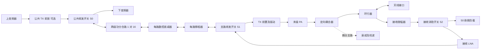

# ADAR1000 与 ADTR1107 射频前端替代方案

更新日期：2026-10-10。适用范围：PLFM_RADAR 的 16 路射频通道，目标工作频段 10～11 GHz，初期低功率调试，预留每路 10 W 级发射能力。本轮 QPA2612 候选按原厂脉冲条件评估，连续波 10 W 能力尚未确认。

建议采用分立数控衰减器、移相器和收发切换网络实现幅相控制，采用独立 PA、接收限幅器和 LNA 实现前端。末级 PA 优先评估 **QPA2612**，QPA2962 保留为原方案对照。PMA6-123-10W+ 价格更低，但典型饱和输出约 8.1 W，只能在降低功率目标后选用。

本方案处于器件选型与采购核验阶段。原理图、PCB、偏置电路、固件和实板测试尚未完成变更；这些器件均不能直接替换原芯片焊接使用。**当前采购清单仍有缺项，不能作为可直接投产的最终 BOM。**

## 1 项目边界与附件

| 项目 | 当前约定 |
| --- | --- |
| 射频范围 | 10～11 GHz，最终仍需核对本振与实际中频扫频范围 |
| 通道数量 | 16 个射频通道，原 4 颗 ADAR1000 各管理 4 路；不等同天线贴片单元总数 |
| 收发方式 | 分时收发 TDD，共用幅相网络；不支持同时收发 |
| 发射目标 | 预留每路 10 W 级能力；连续波或脉冲模式、脉宽、占空比、全温指标及功率测量端口待冻结 |
| 成本取向 | 小批量能采购，优先立创，其次原厂商城与授权分销；可接受较低增益 |
| 保留部分 | 原主控、FPGA、时钟、本振、混频和采样体系，接口及控制程序需相应修改 |

附件与用途：

- [采购核验与降本候选 v2](RF_procurement_v2.xlsx)：37 项射频及控制电源记录，含完整型号、渠道、库存快照、报价档位和缺货状态。
- [采购核验原始数据](procurement_v2_data.json)：与 v2 表格对应的可检索数据。
- [QPA2962 工程选型基线 v1](RF_selection_baseline_v1.xlsx)：保留前一版 40 项选型及计算，供理解方案演进。**其中驱动、增益、负压及功耗预算只适用于旧组合，不适用于直接换成 QPA2612。**

附件数量多为旧架构装配参考量，互斥候选不能相加采购。新 PA 和驱动确定后，应统一修订各级放大、偏置、监测和供电数量，再输出生产 BOM。

## 2 原器件功能与替代边界

| 原器件 | 在原方案中的作用 | 分立替代所需功能 |
| --- | --- | --- |
| ADAR1000 | 4 通道收发波束控制，包含幅度与相位控制、收发控制，以及偏置和检测相关接口 | 每路数控衰减器 DSA、移相器 PS，功分合路、收发选择、必要增益、同步锁存、偏置管理和标定 |
| ADTR1107 | 集成功率放大、接收低噪声放大及收发切换 | 独立 PA、独立 LNA、收发分离和接收保护 |
| QPA2962 | 原外置功放板的单向末级 PA | 只能承担发射功率放大，不包含接收 LNA 或收发分离 |

“用 QPA2962 或 QPA2612 替代 ADTR1107”应理解为重建整条收发前端。单独增加一颗 PA，不能恢复 ADTR1107 的完整功能。分立幅相网络也需要重新实现 ADAR1000 原有的控制和辅助功能。[1]、[2]、[3]

本地项目结构依据见根目录 [README](../../README.md) 的 Hardware Components，以及主板 `4_Schematics and Boards Layout/4_6_Schematics/MainBoard/RADAR_Main_Board.sch`。替代设计的性能不得直接沿用原项目 README 中的距离或输出功率描述。

## 3 推荐拓扑

### 3.1 共用幅相网络

以下表示 16 路中的一路。公共端 S0 选择发射上变频输出或接收下变频输入；每路 S1 选择发射驱动或接收 LNA。天线端采用环行器分离大功率发射与接收，S2 在发射期间将限幅器后端接到 50 Ω 负载。



发射有效路径：

```text
上变频 → 公共前放 → S0 → 两级功分 → DSA → PS → S1
      → TX前置/驱动 → PA → 耦合器主线 → 环行器 → 天线
```

接收有效路径：

```text
天线 → 环行器 → 限幅器 → S2 → LNA → S1
     → PS → DSA → 两级合路 → S0 → 下变频
```

S0、S1 和 S2 都位于小信号侧，不能把 M3SWA2-34DR+ 接到 10 W 发射主线上。共用幅相路径要求 PS、DSA 的正反向性能都满足需求。PE43610 数据手册给出双向压缩指标；MAPS-010166 封装版目前仍需确认反向指标，不能把裸芯片版本的数据直接当作封装版保证。[5]、[6]

### 3.2 功分合路数量

用 EP4RKU+ 搭建两级 1 对 16 网络，合计 5 只：第一级 1 只，第二级 4 只。原第一级器件可复用且布局匹配时，净新增为 4 只。功分预算必须同时计入理想分配损耗与器件额外插损。

若共用幅相路径的反向性能或收发标定无法满足要求，可改为 TX、RX 各自独立的幅相网络。该结构会增加 PS、DSA 和功分合路数量，应作为第二方案重新报价，不能沿用本文 16 只 PS 和 16 只 DSA 的数量。

## 4 末级功放比较

价格为 2026-10-10 检索得到的网页快照，单位为美元，不含运费和税费。库存没有通过收货地址结算验证。

| 型号 | 频率范围 | 功率与使用条件 | 网页报价 | 供货证据 | 结论 |
| --- | --- | --- | --- | --- | --- |
| QPA2612 | 8～12 GHz | 12 W 级饱和输出；数据表大信号测试为 100 μs、10% 占空比；24 V，静态 250 mA | US$295.31，1～24 只档 | 原厂商城详情页显示 66 只 | 优先进行 10 W 级脉冲 PA 样机验证 |
| QPA2962 | 2～20 GHz | 原方案约 10 W 级饱和功率；需要较高驱动；22 V | US$612.95，1～24 只档 | 原厂商城详情页显示 55 只 | 保留作原方案对照，成本偏高 |
| PMA6-123-10W+ | 10～11.7 GHz | 典型 Psat 39.1 dBm，约 8.13 W；不能保证 10 W | US$107.04，20 只档 | 原厂网页索引显示超过 100 只，详情库存需刷新 | 仅在降低输出目标后选用 |

采购页面：[QPA2612][9]、[QPA2962][10]、[PMA6-123-10W+][11]。电气条件以原厂资料为准。[3]、[4]、[7]

按当前价格档计算，仅末级 PA 的比较为：

| 方案 | 装配数量 | 按报价档采购数量 | PA 采购额 |
| --- | ---: | ---: | ---: |
| QPA2962 | 16 | 16 | US$9,807.20 |
| QPA2612 | 16 | 16 | US$4,724.96 |
| PMA6-123-10W+ | 16 | 20 | US$2,140.80 |

QPA2612 相对 QPA2962，16 只 PA 节省 US$5,082.24，约 51.8%。PMA6 一行按 20 只报价计算，含 4 只备料，且功率目标不同，不能当成等功率替代的节省额。

### 4.1 QPA2612 的驱动与偏置变化

QPA2612 数据手册以输入约 +18 dBm 给出大信号测试结果，CW 输入绝对最大值为 +21 dBm。旧 QPA2962 链路按约 +27 dBm 输入配置，**原 PMA5-123-3W+ 加 3 dB 衰减垫的组合不能直接照搬**。绝对最大值也不是正常设计目标，应按全频率、全温度及过冲保留余量。[4]

建议保留 TX 前置和驱动的调试位置，再按公共上变频输出、两级功分、DSA、PS、开关及 PCB 损耗重新选择级数。AVA-183MP+ 可作为较低输出功率驱动的候选，但目前没有冻结它在每路中的数量，也没有确认全链路最差条件下可提供目标输入功率。

QPA2612 需要 24 V 漏极电源及可调负栅偏置。数据手册推荐工作栅压范围约为 −2.8～−2.0 V，应以每只器件的静态电流校准；−5～0 V 是栅极绝对最大范围，不能将负电源轨直接作为统一工作或关断电压。其 RF 端口为直流接地结构，隔直与偏置网络需按原厂参考电路重新设计。[4]

### 4.2 PA 输出与天线口输出

若 PA 输出为 40 dBm，假设环行器损耗 0.5 dB、耦合器及走线共损耗 0.5 dB，则天线口为 39 dBm，约 7.94 W。这里的 1 dB 是预算示例，并非板级测量。

严格要求天线口 10 W 时，应为主线损耗及全温性能留出 PA 输出余量。QPA2612 的脉冲资料可作为选型依据，但不能据此承诺任意脉宽、占空比或连续波状态下的天线口功率。

## 5 主要射频器件候选

| 功能 | 完整型号 | 16 路数量口径 | 选型说明 |
| --- | --- | --- | --- |
| 末级 PA | QPA2612 | 16 | 优先试样候选，脉冲条件待项目确认 |
| 数控衰减 | PE43610A-X | 16 | 9 kHz～13 GHz，6 位、0.5 dB 步进、31.5 dB 范围 |
| 移相 | MAPS-010166-TR0500 | 16 | 8～12 GHz，6 位；共用网络反向性能待确认 |
| TX 前置及 RX LNA | PMA2-123LNW+ | 原基线 32 | 每路 TX/RX 各 1 只；新 TX 驱动确定后重算 |
| 支路、消隐及公共开关 | M3SWA2-34DR+ | 33 | 每路 2 只，公共端 1 只，仅小信号侧 |
| 接收限幅 | TGL2209-SM | 16 | 额定承受能力必须按脉冲条件和失配情况校核 |
| 功分合路 | EP4RKU+ | 总装配 5 | 原第一级可复用时净增 4 |
| 公共 TX 前放 | AVA-183MP+ | 原基线预留 1 | 根据上变频输出决定是否装配；逐路驱动另算 |
| 功率检波 | ADL6010ACPZN-R7 | 原基线 16 | 有货但成本高，暂不认定为低成本最终选择 |
| 驱动/检波衰减垫 | XAT-3+、XAT-10+ | 原基线各 16 | 前者随新 PA 输入预算重选；后者随耦合度重选 |
| 环行器 | UIYBDC815A8T12 | 16 | 规格候选，零售现货尚未确认 |
| 调试耦合器 | ZCDC20-263+ | 调试共用 1 | 本轮未确认现货；不默认每路常驻一只 |

PE43610A-X 的 8～13 GHz 插损典型为 2.5 dB、最大为 3 dB，衰减设置变化也会引入相位变化，须一起标定。正常模式由 3.3 V 供电并启用内部负压发生器，射频稳定时间约 500 ns，衰减状态切换频率上限 400 kHz。低杂散旁路模式需要外加负电源，不能直接照抄正常模式接法。[5]

MAPS-010166 的插损典型为 6.5 dB、最大为 9 dB，控制方案按 ±5 V 电源评估。VCC 为 5 V 时，逻辑高电平要求至少 0.7×VCC，即 3.5 V，因此不能保证由 3.3 V GPIO 直接驱动，应保留电平转换。6 位移相步进和误差不等同于 ADAR1000 的原控制分辨率。[6]

## 6 控制电源与数量修订

下表记录原 QPA2962 加 PMA5 驱动组合的配套基线。换用 QPA2612 后，应以最终受控功放级数和电源负载重新计算，不能直接按表中全部数量下单。

| 功能 | 型号 | 原基线数量 | 修订条件 |
| --- | --- | ---: | --- |
| PA 偏置、电流及慢速监测 | AD7293BCPZ | 8 | 原每组 4 路含两级受控功放；若驱动不再需要负栅偏置，可重评数量 |
| 栅压缓冲 | OPA4197IPWR | 8 | 所查渠道缺货；需另选封装或替代电路 |
| 栅压切换 | TMUX6219DGKR | 32 | 数量跟随受控栅极数量 |
| 移相锁存及电平转换 | SN74AHCT595PWR | 16 | 保留 5 V 控制能力，或另设计串行电平转换 |
| 衰减锁存 | SN74LVC595APWR | 16 | 使用 PE43610 原生串行接口时可重评 |
| 时序缓冲 | SN74LVC244APWR | 4 | 根据负载、布线和 IO 调整 |
| 硬件许可逻辑 | SN74LVC08APWR | 4 | 按负压、过流、过温及 FPGA 许可逻辑调整 |
| 电源监控 | TPS3700DDCR | 4 | 负压监测需电平平移网络 |
| 漏极采流电阻 | WSL2512R0100FEA | 32 | 10 mΩ 候选，阻值及功率随工作电流重算 |
| 局部温度采样 | MMBT3904LT1G | 16 | AD7293 减量后还需重核可用温度输入数 |
| 主 PA 母线控制器 | LM5146RGYR | 4 | QPA2612 为 24 V；MOS、电感、补偿和限流尚未定型 |
| 驱动供电模块 | TPSM63610RDFR | 4 | 原用于 7 V；新驱动选择后重设电压及负载 |
| 5 V 低噪声 LDO | TPS7A4701RGWR | 8 | 所查渠道缺货，需重新选型 |
| 3.3 V LDO | TPS7A2033PDBVR | 4 | 300 mA 级，按新幅相和逻辑负载复核 |
| 负压产生 | TPS63700DRCR | 4 | 按输出电压及实际负载校核能力 |
| 负压低噪声 LDO | TPS7A3001DGNR | 12 | 可采购卷带后缀；负电源轨数量随架构重算 |
| 公共前放 8 V 电源 | LM5164DDAR | 1 | 若 AVA 扩展为逐路驱动，不可用单个 1 A 电源带全部通道 |
| 漏极 eFuse | TPS26630RGER | 32 | 所查渠道缺货；不作为快速 RF 脉冲门控器 |
| 主控制器 | STM32F746ZGT7 | 沿用 1 | 本次不替换 MCU；不将复用数量当作新增采购 |

AD7293 属于慢速监测及偏置管理链路。若要求测量很窄的发射脉冲幅度，需要另行设计同步采样或峰值保持，不能仅凭检波器速度认定整条采样链足够快。

主板原有偏置 DAC、采流 ADC 和温度采集资源应在新原理图中逐项核对复用可能性。不能既保留原功能全部采购量，又默认新增 AD7293 数量代表最终最小成本。

## 7 偏置时序与接收保护

建议的上电顺序为：负压建立并确认有效 → 栅极保持关断电压 → 漏极限流供电 → 逐只校准静态电流 → 允许 RF 输入。关机先撤销 RF，再按器件要求关闭偏置。故障情况下应通过硬件撤销漏极许可，并核对储能电容的放电路径。

FPGA 负责确定性的收发、消隐和幅相锁存时序；MCU 负责配置、慢速监控及标定表管理。发射期间应保持已校准的偏置或使用正确的电流环消隐，避免慢速静态电流闭环追踪 RF 包络。

若环行器隔离为 18 dB，40 dBm 发射会产生约 22 dBm 的直接泄漏。天线失配时，反射功率还会从环行器进入接收支路，最坏情况不能只按这 22 dBm 计算。TGL2209-SM 标称 50 W 承受能力对应规定脉冲条件，不等于能够长期吸收 10 W 连续反射功率。[8]

应联合验证限幅器、S2、50 Ω 负载及 LNA 的承受能力和恢复时间。初期调试使用额定功率足够的 50 Ω 假负载，测量 PA 输入和输出后再提升功率。

## 8 功耗与热设计

QPA2612 的 24 V、250 mA 对应单只约 6 W 的静态耗电，16 只约 96 W。该数值不含驱动、接收、幅相、供电损耗，也不代表发射工作时的功耗。RF 驱动下漏极电流会明显增大，需按原厂曲线与实测工作波形计算。[4]

PA 平均热耗可按以下关系起算，再加入切换过程与偏置状态差异：

```text
发射热耗 ≈ 发射状态直流输入功率 + RF输入功率 − RF输出功率
平均热耗 ≈ 发射热耗 × 占空比 + 非发射状态热耗 × (1 − 占空比)
```

低占空比并不自动消除静态耗电。是否在接收间隔关闭或降低 PA 偏置，取决于允许的恢复时间、相位稳定和器件时序。散热需结合外壳温度、热阻、接地焊盘、铜热扩散板、导热界面及风冷或冷板设计。

## 9 采购核验与成本限制

附件 v2 将证据分为四类：A 为读取到商品详情库存，B 为较旧页面或搜索索引、需要刷新，C 为缺货或采购未确认，D 为项目沿用。A 也不是已锁定库存或已验证向中国地址发货。

可作为当前试样渠道的主要记录如下：

| 型号 | 网页价格档 | 网页库存 | 渠道 |
| --- | --- | ---: | --- |
| QPA2612 | US$295.31，1～24 只 | 66 | [原厂商城][9] |
| MAPS-010166-TR0500 | US$120.525，10 只档剪带 | 390 | [DigiKey][12] |
| PE43610A-X | US$22.754，10 只档剪带 | 1704 | [DigiKey][13] |
| TGL2209-SM | US$72.08，1～24 只 | 334 | [原厂商城][14] |
| ADL6010ACPZN-R7 | US$207.958，10 只档 | 2161 | [DigiKey][15] |

ADL6010 单项价格已很高。初期可以使用外部仪器完成单路功率测量，但取消逐路在线检波会改变系统功能，不能作为已确认的量产降本措施。完整成本应比较原 4 颗 ADAR1000、16 颗 ADTR1107 及选配 PA，与新方案全部幅相、放大、保护、控制、PCB 和散热成本。

当前影响整套采购的主要缺项：

- UIYBDC815A8T12 环行器只有规格候选，尚未确认零售现货。
- OPA4197IPWR、TPS7A4701RGWR、TPS26630RGER 所查渠道缺货，需要另选实际可购的型号或电路。
- PCB 耦合器、微波 50 Ω 端接、隔直、匹配及偏置无源件尚未完成选值和封装确定。
- 滤波器、RF 连接件、主电源外围和散热结构需随布局、频谱及功率指标定型。

本轮没有核实到具有明确 SKU、价格与可确认供货条件的淘宝低价商品，因此未将淘宝搜索页当作可采购链接。网页库存和价格变动后，应保留旧版本并生成新的采购快照。

## 10 验证与实施顺序

1. **冻结输入条件**：实际射频范围、脉宽、占空比、PA 端或天线口功率、环境温度、主电源输入、允许接收恢复时间和幅相误差。
2. **单路供电与偏置**：无 RF 输入时验证上电、关断、失电、过流和过温流程，记录逐只静态电流工作点。
3. **单路发射**：从低输入开始，量测逐级增益、压缩、PA 输入输出、杂散及温升，校核全频和最差损耗。
4. **单路收发与保护**：验证泄漏、受控反射条件、限幅/消隐负载及 LNA 恢复时间，再建立最短收发切换窗口。
5. **四路幅相标定**：逐状态测量相位与幅度，分别建立 TX 和 RX 校准表；确认寄存器预装、同步锁存及稳定时间。
6. **扩展十六路**：检查通道一致性、电源串扰、同步误差、热分布和阵列性能。
7. **冻结工程文件**：完成原理图、PCB、无源件 BOM、替代料规则、软件接口和测试记录后，才生成生产与采购版本。

本方案没有提供原理图替换或 PCB 已验证的结论，也不保证保持原项目的探测距离。所附选型及采购记录用于推进样机，不能替代上述测试。

## 11 资料来源

- [1] [ADI ADAR1000 产品与资料](https://www.analog.com/en/products/adar1000.html)
- [2] [ADI ADTR1107 产品与资料](https://www.analog.com/en/products/adtr1107.html)
- [3] [Qorvo QPA2962 产品与资料](https://www.qorvo.com/products/p/QPA2962)
- [4] [Qorvo QPA2612 数据手册 Rev. B](https://www.mouser.com/datasheet/2/412/QPA2612_Data_Sheet-1771779.pdf)，重点见推荐工作条件、绝对最大值与脉冲大信号曲线。
- [5] [pSemi PE43610 数据手册](https://www.psemi.com/pdf/datasheets/pe43610ds.pdf)，重点见供电模式、电气指标和切换速度。
- [6] [MACOM MAPS-010166 数据手册](https://cdn.macom.com/datasheets/MAPS-010166.pdf)，重点见插损、供电和逻辑门限。
- [7] [Mini-Circuits PMA6-123-10W+ 数据手册](https://www.minicircuits.com/pdfs/PMA6-123-10W%2B.pdf)
- [8] [Qorvo TGL2209-SM 产品与资料](https://www.qorvo.com/products/p/TGL2209-SM)
- 完整采购页面和快照数值见 [v2 数据文件](procurement_v2_data.json) 与 [v2 表格](RF_procurement_v2.xlsx)。

[1]: https://www.analog.com/en/products/adar1000.html
[2]: https://www.analog.com/en/products/adtr1107.html
[3]: https://www.qorvo.com/products/p/QPA2962
[4]: https://www.mouser.com/datasheet/2/412/QPA2612_Data_Sheet-1771779.pdf
[5]: https://www.psemi.com/pdf/datasheets/pe43610ds.pdf
[6]: https://cdn.macom.com/datasheets/MAPS-010166.pdf
[7]: https://www.minicircuits.com/pdfs/PMA6-123-10W%2B.pdf
[8]: https://www.qorvo.com/products/p/TGL2209-SM
[9]: https://store.qorvo.com/products/detail/qpa2612-qorvo/658743/
[10]: https://store.qorvo.com/products/detail/qpa2962-qorvo/682240/
[11]: https://www.minicircuits.com/WebStore/dashboard.html?model=PMA6-123-10W%2B
[12]: https://www.digikey.com/en/products/detail/macom-technology-solutions/MAPS-010166-TR0500/4429765
[13]: https://www.digikey.com/en/products/detail/psemi/PE43610A-X/22251085
[14]: https://store.qorvo.com/products/detail/tgl2209sm-qorvo/578487/
[15]: https://www.digikey.com/en/products/detail/analog-devices-inc/ADL6010ACPZN-R7/5403657
